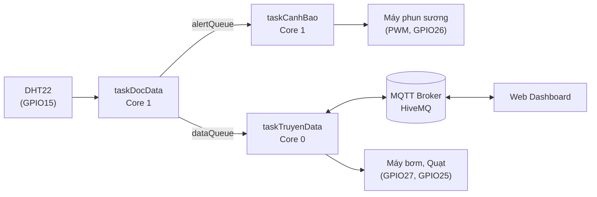

# Lab 3 – Đề 2: Giám sát vườn cây công nghiệp với ESP32, FreeRTOS và MQTT

Hệ thống theo dõi và điều khiển môi trường vườn **cà phê, hồ tiêu** dùng **ESP32 + cảm biến DHT22**. Chương trình chạy **FreeRTOS** trên hai nhân, gửi dữ liệu qua **MQTT** và hiển thị trên một **Web Dashboard**. Toàn bộ dự án được mô phỏng trên **Wokwi**.

| | |
|---|---|
| **Sinh viên** | Nguyễn Đăng Anh Minh |
| **MSSV** | 231432297 |
| **Lớp** | Cử nhân Kỹ thuật Điện tử Viễn thông K64 |
| **Bài thực hành** | Lab 3 – Đề 2 |

## Giới thiệu

Cây cà phê và hồ tiêu phát triển tốt khi độ ẩm không khí giữ ổn định trong khoảng **40% – 60%**. ESP32 đọc nhiệt độ, độ ẩm từ DHT22 mỗi 2 giây, in ra Serial và gửi lên MQTT Broker. Khi độ ẩm xuống dưới 40%, **máy phun sương** tự bật theo ba mức công suất. Người dùng xem số liệu, biểu đồ và bật tắt **máy bơm**, **quạt** ngay trên trang web.

## Chức năng chính

- Đọc DHT22, lọc trung bình 3 mẫu để giảm nhiễu, hiển thị trên Serial Monitor.
- Gửi số liệu lên MQTT Broker (HiveMQ) qua Wi-Fi, tự kết nối lại khi mất mạng.
- Web Dashboard gồm: thẻ nhiệt độ, thẻ độ ẩm, ống đo độ ẩm có vùng 40% – 60%, trạng thái máy phun sương, 2 biểu đồ thời gian thực.
- Công tắc **máy bơm** và **quạt** phản hồi ngay khi bấm; ESP32 xác nhận lại trạng thái thật.
- Máy phun sương điều khiển bằng **PWM**, chạy tự động theo độ ẩm, đếm thời gian bằng `millis()` nên không chặn các Task khác.
- Tự tắt máy phun nếu mất dữ liệu cảm biến quá 10 giây (fail-safe).

## Kiến trúc hệ thống

## Phần cứng và sơ đồ chân

| Thiết bị | Chân ESP32 | Ghi chú |
|---|---|---|
| DHT22 (DATA) | GPIO15 | Nhiệt độ, độ ẩm |
| Máy phun sương (LED xanh dương) | GPIO26 | PWM 0 – 255 |
| Máy bơm (LED xanh lá) | GPIO27 | BẬT/TẮT từ web |
| Quạt (LED vàng) | GPIO25 | BẬT/TẮT từ web |

Board: ESP32 DevKit V1. Ba LED (mỗi LED qua điện trở 220 Ω) đại diện cho các cơ cấu chấp hành trong mô phỏng.

## Tổ chức FreeRTOS

| Task | Core | Ưu tiên | Chức năng |
|---|---|---|---|
| `taskTruyenData` | 0 | 1 | Kết nối Wi-Fi/MQTT, gửi dữ liệu, nhận lệnh bơm/quạt |
| `taskDocData` | 1 | 2 | Đọc DHT22, in Serial, gửi dữ liệu vào 2 Queue |
| `taskCanhBao` | 1 | 2 | Nhận độ ẩm, điều khiển máy phun sương |

- `dataQueue`: nhiệt độ + độ ẩm, đi tới `taskTruyenData`.
- `alertQueue`: chỉ độ ẩm, đi tới `taskCanhBao`.
- `stateMutex`: bảo vệ trạng thái dùng chung của máy phun sương, bơm và quạt.

## Thuật toán máy phun sương

| Độ ẩm (%) | Công suất | PWM | Thời gian |
|---|---|---|---|
| ≥ 40 | Tắt | 0 | – |
| 35 ≤ H < 40 | 25% | 63 | 10 giây |
| 30 ≤ H < 35 | 50% | 127 | 20 giây |
| < 30 | 100% | 255 | 30 giây |

`taskCanhBao` là một máy trạng thái **IDLE → RUNNING → REST**:

- Đang phun mà độ ẩm giảm sang dải thấp hơn thì tự nâng công suất.
- Độ ẩm đạt từ 40% trở lên thì tắt ngay.
- Sau mỗi đợt phun nghỉ 5 giây để bảo vệ máy, rồi mới xét đợt tiếp theo.

## Giao thức MQTT

Broker: `broker.hivemq.com` (ESP32 dùng cổng 1883, web dùng WebSocket bảo mật `wss://…:8884/mqtt`).

| Topic | Hướng | Nội dung |
|---|---|---|
| `vuon_cay_cn/data` | ESP32 → Web | `{"t":28.0,"h":45.5,"mist":0,"pump":0,"fan":0,"rssi":-60,"up":120}` |
| `vuon_cay_cn/status` | ESP32 → Web | `online` / `offline` (retained, Last Will) |
| `vuon_cay_cn/cmd/pump` | Web → ESP32 | `ON` / `OFF` |
| `vuon_cay_cn/cmd/fan` | Web → ESP32 | `ON` / `OFF` |
| `vuon_cay_cn/state/pump` | ESP32 → Web | `ON` / `OFF` (xác nhận trạng thái, retained) |
| `vuon_cay_cn/state/fan` | ESP32 → Web | `ON` / `OFF` (xác nhận trạng thái, retained) |

## Cách chạy

1. Mở project Wokwi (link ở cuối trang) và bấm **Start**.
2. Mở Web Dashboard (link ở cuối trang). Trạng thái góc trên sẽ chuyển sang **ESP32 trực tuyến**.
3. Trong Wokwi, kéo thanh **Humidity** của DHT22 xuống dưới 40% để kiểm tra từng mức phun sương. Số liệu được lọc 3 mẫu nên cần chờ khoảng 4 – 6 giây để thấy thay đổi.
4. Bấm công tắc **Máy bơm** hoặc **Quạt** trên web, LED tương ứng trong Wokwi sẽ bật hoặc tắt.

> Web chỉ hiển thị số liệu khi mô phỏng Wokwi đang chạy. Nếu chưa chạy, các thẻ số hiện `--`.

### Chạy trên board thật

Thay `WIFI_SSID` và `WIFI_PASS` trong `sketch.ino` bằng Wi-Fi của bạn. Cần thêm MOSFET hoặc relay và nguồn riêng cho máy phun sương, bơm, quạt thay cho LED.

## Cấu trúc kho lưu trữ

| File | Nội dung |
|---|---|
| `Nguyễn Đăng Anh Minh 231432297` (.docx, .pdf) | Báo cáo thực hành |
| `sketch.ino` | Mã nguồn ESP32 (FreeRTOS, MQTT, PWM) |
| `diagram.json`, `libraries.txt` | Sơ đồ mạch và thư viện cho project Wokwi |
| `index.html` | Giao diện Web Dashboard |
| `README.md` | Giới thiệu tổng quan dự án |

## Thư viện sử dụng

- ESP32: `DHT sensor library`, `Adafruit Unified Sensor`, `PubSubClient`.
- Web: `mqtt.js` 5.10.1 và `Chart.js` 4.4.1 (nạp từ CDN jsDelivr).

## Liên kết trực quan

Mô phỏng Wokwi: [Xem mô phỏng trên Wokwi](https://wokwi.com/projects/480643213687101441)

Web Demo: [Xem trang web demo](https://webgiamsat.netlify.app)
